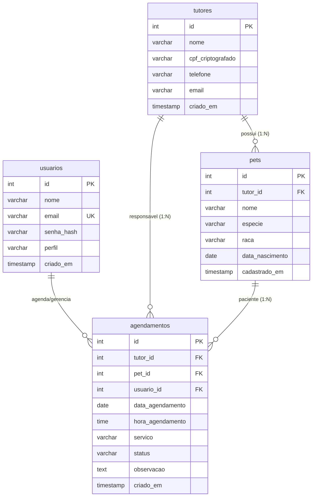

# Sistema de Gerenciamento de Clinica Veterinária - Cuidamigos

## 1. Contextualização
Uma clínica veterinária enfrenta dificuldades em sua rotina de atendimentos devido à ausência de um sistema informatizado. O controle manual dos agendamentos e dos registros de tutores e pets tem ocasionado perda de consultas, duplicidade de informações e falhas no armazenamento de dados. Além disso, a ausência de mecanismos adequados de proteção dos dados pessoais dos tutores, como o CPF, pode comprometer a segurança dessas informações e resultar no descumprimento das disposições da Lei Geral de Proteção de Dados (LGPD).
Para resolver essa situação, o gestor da clínica contratou sua equipe para desenvolver uma solução de software que organize o processo de agendamento e gestão de informações. Durante a reunião inicial, o gestor destacou a importância da autenticação dos usuários com tempo de expiração, da proteção dos dados pessoais armazenados e da documentação técnica do sistema, incluindo requisitos funcionais e geração do diagrama entidade relacionamento, a fim de garantir a manutenção futura do sistema.
Após a reunião com o gestor da clínica, foram definidos algumas regras de negócio:
- No script do banco de dados devem existir pelo menos três registros para todas as tabelas criadas, respeitando os tipos de dados, chaves primárias e estrangeiras.
- Na funcionalidade de login, fazer validação em caso de falha na autenticação.
- O CPF dos tutores deve ser armazenado de forma criptografada no banco de dados.
- A funcionalidade principal do sistema deve exibir: nome do usuário logado e uma forma de
acessar os demais recursos, assim como uma maneira de sair do sistema.
- A funcionalidade de tutor deve conter: um recurso de busca para que o usuário possa inserir o termo, o qual, após inserção e confirmação, deverá exibir para o usuário a atualização da listagem dos valores da tabela com os registros que correspondem. A funcionalidade também deve permitir editar os dados de um tutor já cadastrado, salvando a alteração no banco de dados.
- A funcionalidade de agendamento deve exibir: Listagem dos agendamentos cadastrados ordenado por dia de agendamento, trazendo todos dados do tutor e do pet. A funcionalidade também deve permitir atualizar a data de um agendamento já cadastrado, salvando a alteração no banco de dados.
- Ao cadastrar um novo pet, o usuário deve associá-lo a um tutor.

## 2. Desafio
Você, como desenvolvedor deverá criar um sistema que permita o cadastro e gerenciamento de tutores, pets e agendamentos, com autenticação de usuários e controle seguro de dados.

## 3. Introdução 
Este documento tem como objetivo detalhar os processos e os requisitos para a execução da avaliação prática de desempenho do estudante. Para realizar a atividade seram utilizadas as tecnologias: 
- PHP 8.5
- PostgreSQL
- PDO
E para organização, a arquitetura a ser utilizada será MVC Artesanal e Autoload PSR-4 via composer. 

## 4. Requisitos
### 4.1. Requisitos Funcionais
| ID | REQUISITO | DETALHAMENTO | 
| --- | --- | --- |
| RF01 | Funcionalidade de Tutor | cadastro das informações criptografando dados sensiveis, pesquisa por termo e listagem de resultados e permissão na alteração de dados dos tutores. | 
| RF02 | Cadastro de Pet | O sistema deve permitir o cadastro de novos pets e,ao fazer isso, deve associá-lo ao seu tutor |
| RF03 | Funcionalidades de Agendamentos | deve listar os agendamentos já cadastrados ordenados por ano com os dados do tutor e do pet. além disso, deve pertimir atualizar a data do agendamento alterando, também, o banco de dados. | 
| RF04 | Login, Autenticação e Logout | O sistema deve autenticar o usuário com email e senha, exibindo erro se o acesso não for liberado. Após 15 minutos de inatividade o sistema deve encerrar a sessão destruindo os dados do usuário | 

### 4.2. Requisitos Não funcionais 
| ID | REQUISITO | DETALHAMENTO | 
| --- | --- | --- | 
| RNF01 | Arquitetura | A arquitetura do sistema deve seguir o MVC (Models, Views e Controllers) |
| RNF02 | Autoloading | o sistema deve fazer o carregamento automático seguindo o mapeamento via PSR-04 | 
| RNF03 | Proteção e criptografia | O sistema deve ser protegido permitindo o acesso apenas a pessoas cadastradas. Além disso, os dados sensíveis devem ser criptografados, como é o caso do CPF. | 
| RNF04 | Armazenamento em BD Relacional | O sistema deve ser integrado e armazenar os seus dados em um banco de dados relacional, como por exemplo, o Postgres SQL. Todas as atualizações devem ser sincronizadas com o banco | 

### 5. Diagrama de Entidade Relacional (DER)

## Entregas 
Para atingir uma boa nota, será preciso entregar:
- Documentação de Software;
- Diagrama Entidade Relacionamento (DER);
- Script de criação e população do banco de dados;
- Código fonte da funcionalidade do login;
- Código fonte da funcionalidade principal do sistema;
- Código fonte da funcionalidade do gerenciamento Tutor;
- Código fonte da funcionalidade do gerenciamento Pet;
- Codigo fonte da funcionalidade do gerenciamento de Agendamentos.